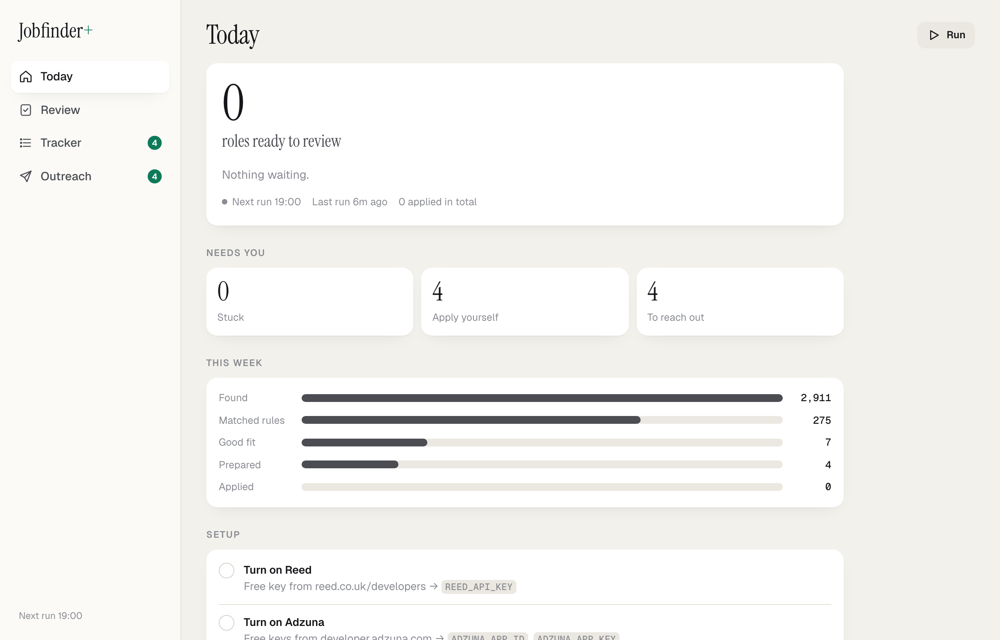
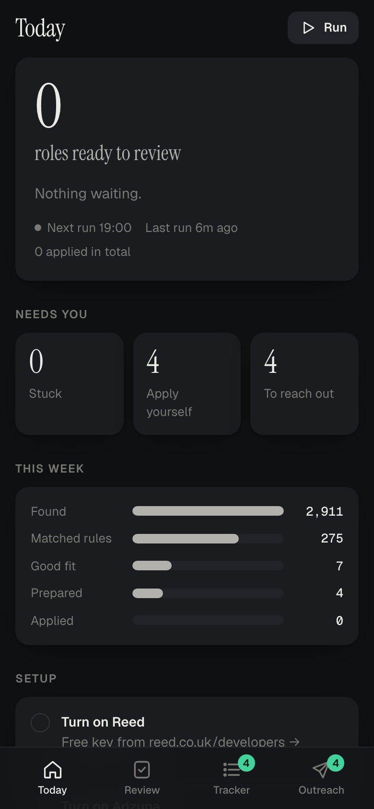
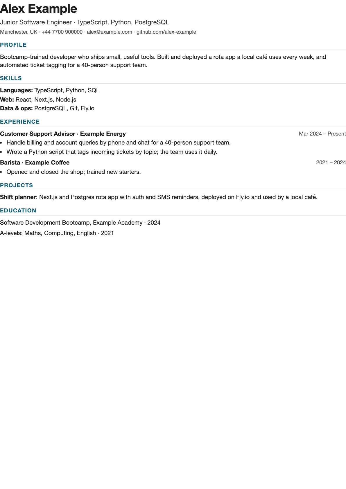

# Jobfinder+

A job-application assistant that runs on your own machine. It finds roles, scores how well you fit them, writes a tailored CV and cover letter for each one, fact-checks them against your real history, fills in the application form, and drafts LinkedIn outreach. You review everything on your phone and approve with one tap.

<p>
  
  
</p>

## Why

Most applications are screened by software before a person reads them. Tailoring every CV by hand doesn't scale; spraying one generic CV doesn't work. Jobfinder+ automates the tailoring while keeping you honest and in control:

- **Nothing invented.** Every CV is built only from `profile/master.md`. A second model compares each draft against it and lists anything unsupported; the writer redrafts until it's clean, and anything still flagged is shown to you before you approve. Sections marked unconfirmed are stripped before any model sees the file.
- **Nothing sent without you.** Applications wait in a review queue. LinkedIn messages are drafted, never sent: you pick the person and paste the note, so your account is never automated.
- **No dark patterns.** It doesn't bypass CAPTCHAs, log into sites for you, or scrape behind logins. When a site needs a human, the job moves to a "Stuck" or "Apply yourself" list with everything prepared.

## How it works

```
discover ──► filter ──► score ──► prepare ──────────────────────► review ──► submit
 job boards   title,     model     tailored CV + cover letter      phone       fills the form,
 + company    level,     rates     → fact-check → redraft          dashboard   stops at captchas
 ATS APIs     location,  fit       → PDF → read the live form                  or unknown fields
              salary     0–100     → draft answers + outreach
```

| Step | Details |
|---|---|
| Discover | Greenhouse, Lever, Ashby and Workable job-board APIs for chosen companies, LinkedIn's public job search (no login), Reed and Adzuna APIs, RemoteOK, We Work Remotely. Company boards found through LinkedIn and Reed links are added automatically. |
| Filter | Title, seniority, location (commutable area, UK-wide, or remote open to the UK), salary floor, excluded phrases such as clearance requirements. |
| Score | A model rates realistic fit against your profile, with reasons, gaps and dealbreakers. Roles above your threshold are shortlisted. |
| Prepare | Per-track CV angles (e.g. data, solutions, sales, AI builder), cover letter, fact-check loop, A4 PDFs, form extraction with Playwright, drafted answers to every question, LinkedIn people-search links and notes. |
| Review | Phone-first dashboard: CV preview, editable letter and answers (uncertain ones flagged), one-tap approve. |
| Submit | Fills and submits Greenhouse, Lever, Ashby and Workable forms. Anything else gets **Fill on Mac**: a visible browser fills the form and leaves the final click to you. |



*A tailored CV generated from the fictional example profile.*

## Stack

TypeScript · Node.js · Express · SQLite (better-sqlite3) · Playwright · Claude (structured outputs) · Zod · vanilla JS dashboard (no build step) · node-cron

Claude is reached either through the Claude Code CLI on a Claude subscription (default, no API credit needed) or the Anthropic API.

## Setup

```bash
npm install
npx playwright install chromium
cp .env.example .env
cp profile/settings.example.yaml profile/settings.yaml
cp profile/master.example.md profile/master.md
claude            # once: /login with your Claude account
npm start         # http://localhost:4319
```

1. Write your real history in `profile/master.md`. Keep it true; it's the only source the bot uses.
2. Set targets, locations, company boards and standard answers in `profile/settings.yaml`.
3. Tap **Run** on the dashboard, or leave it running: it checks for jobs at 07:00, 13:00 and 19:00.

To use the dashboard from your phone on the same Wi-Fi, set `DASHBOARD_TOKEN` in `.env` and open `http://<your-computer>.local:4319/?t=<token>` once.

## Project layout

```
src/
  sources/     job board adapters (ATS APIs, LinkedIn guest search, Reed, Adzuna, remote boards)
  filter.ts    rule-based filtering and dedupe
  score.ts     fit scoring
  tailor.ts    CV + cover letter writing and the fact-check loop
  render.ts    HTML → PDF
  apply/       form extraction, answer drafting, submission, Fill-on-Mac assist
  outreach.ts  LinkedIn drafts
  pipeline.ts  orchestration and the daily cycle
  server.ts    API + schedule
web/           dashboard
profile/       your profile (git-ignored) and examples
data/          SQLite, PDFs, screenshots (git-ignored)
```

## Notes

- Your profile, settings, database and generated documents are git-ignored and never leave your machine except as part of an application you approve.
- Job boards change their markup; adapters are small and easy to fix.
- Built with [Claude Code](https://claude.com/claude-code).

## Licence

MIT
